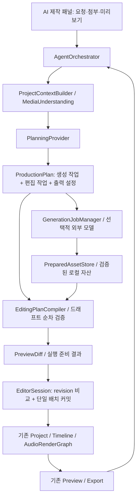

# MovieCut AI 영상 제작 상세 구현 계획

작성: 2026-10-05 · 코드 확인 기준: `2e72bcc` · 상태: **구현 전 계획 / 다른 세션 실행용**

## 1. 목표와 범위

사용자가 사진·영상·음원을 첨부하고 자연어로 요청하면, AI가 자료를 이해하고 편집 가능한 타임라인을 구성하며, 음악·효과음을 배치하고 최종 영상을 출력한다. 필요한 경우 외부 생성 모델로 이미지·영상·음원을 만든 뒤 같은 프로젝트에서 편집한다.

대표 요청:

> “이 여행 사진 10장으로 세로 30초 영상을 만들어줘. 사진은 천천히 움직이고, 밝은 음악을 깔고, 장면 전환에 효과음을 넣어줘. 마지막에는 ‘다음 여행에서 만나요’라고 써줘.”

추가 수정:

> “세 번째 사진을 2초 더 보여줘. 전체는 30초를 유지하고, 마지막 효과음은 빼줘. 내레이션이 나오는 동안 음악을 줄여줘.”

완료의 의미는 편집 코드나 대화 UI의 존재가 아니라 **요청 → 자료 선택 → 계획 → 타임라인 → 미리보기 → 수정 → 저장·재열기 → 출력**이 이어지고, 사용자가 각 클립을 직접 수정할 수 있는 것이다.

### 출시 범위 구분

| 단계 | 제공 가치 | 포함 | 다음 단계로 넘길 항목 |
|---|---|---|---|
| A: 첨부 미디어 자동 편집 | 기존 사진·영상·음원으로 초안 완성 | 사진 움직임, 컷 구성, 텍스트, BGM·효과음 배치, 기본 믹싱, 수정·출력 | 새로운 장면·음원의 모델 생성 |
| B: 생성 통합 | 부족한 영상·음원을 생성해 사용 | 이미지 생성, 사진→영상, 텍스트→영상, 음악·효과음 생성, 선택적 내레이션 | 여러 업체 동시 지원, 고급 자동 재생성 |
| C: 제작 품질 확장 | 좋은 초안을 반복해서 제작 | 장면 의미 검색, 편집 스타일 저장, 비트 동기화 고도화, 품질 평가 | MCP·iOS AI UI는 별도 후속 범위 |

단계 A에는 실제 모델 기반 자연어 계획 기능이 포함된다. 규칙 기반 데모만으로 “AI 제작 완료”라고 판정하지 않는다. 단계 A 개발 중에는 결정론적 테스트 플래너를 먼저 붙여 편집 경로를 검증할 수 있다.

## 2. 현재 상태와 재사용 지점

아래는 이번 세션의 정적 코드 확인이다. 앱 실행·렌더링·테스트 재실행은 하지 않았으며, 기존 문서의 측정 결과를 이번 검증 결과로 취급하지 않는다.

| 영역 | 확인한 코드 | 구현상 의미 |
|---|---|---|
| 앱의 기존 도우미 | `App/MovieCutMac/EditorViewModel+AssistantProvider.swift` | `RuleBasedEditingProvider` → `AIEditPlan.intents` → `executeAssistantIntent`로 실제 연결되어 있음 |
| 기존 AI 인터페이스 | `Sources/MovieCutCore/AI/AIEditingProvider.swift` | 현재 context는 클립 개수·선택 유무 정도이며 의미 분석·타임라인 계획에는 부족 |
| 별도 P3 편집 액션 | `Sources/MovieCutCore/Editing/EditingActionDSL.swift` | 삭제·유지·분할·이동·볼륨·속도·EQ·덕킹·무음 제거의 10종 |
| P3 적용기 | `Sources/MovieCutCore/Editing/EditingActionApplier.swift` | 전체 액션을 원본 프로젝트 기준으로 검증·컴파일한 뒤 배치 적용 |
| 배치·Undo | `EditingActionBatchCommand.swift`, `EditorAPI/EditorSession.swift` | 드래프트 적용·단일 undo 기반 재사용 가능 |
| 가져오기·타임라인 | `Media/MediaImporter.swift`, `Commands/ImportMediaCommand.swift`, `AddClipCommand.swift`, `CreateTrackCommand.swift` | 이미지·영상·오디오 자산 등록 및 클립 구성의 기반 |
| 속성·합성 | `Commands/SetClipPropertyCommand.swift`, `Rendering/` | transform·keyframes·transition·textContent 등 재사용 |
| 오디오 | `Audio/AudioRenderGraphSpec.swift`, `Audio/SpeechDuckingService.swift`, `Analysis/BeatDetectionProvider.swift` | 기존 그래프·덕킹·비트 분석에 AI의 결정 결과를 연결 |
| 출력 | `App/MovieCutMac/Export/ExportEngine.swift`, `EditorViewModel+Export.swift` | 기존 출력 엔진 호출, 새 인코더 작성 불필요 |
| 음악 목록 | `Models/MusicLibrary.swift` | `placeholder()`에 시스템 효과음을 사용하는 예시 목록 존재. 실제 BGM 공급원으로 간주 금지 |

### 먼저 해결해야 할 구조적 간극

1. **두 도우미 경로 통합**: 앱의 기존 `AssistantIntent` 실행 경로와 P3 DSL 경로가 나뉘어 있다. 기존 기능을 조사·매핑하고, AI 타임라인 변경은 최종적으로 동일한 검증·실행 경계를 사용한다.
2. **순차 계획 지원**: 현재 적용기는 모든 액션을 원본 상태로 검사한다. `트랙 생성 → 자산 등록 → 클립 추가 → 그 클립에 효과 적용`을 지원하려면 앞선 액션을 반영한 드래프트로 후속 액션을 검증해야 한다.
3. **오래된 계획 방지**: `snapshot → async 분석 → dispatch` 사이 사용자가 편집할 수 있다. 현재 `EditorSession`에 계획용 revision 비교 커밋이 없으므로 추가한다.
4. **첨부와 생성 결과 관리**: 파일 접근·다운로드·분석은 타임라인 명령 실행과 수명 주기가 다르다. 준비한 미디어와 프로젝트 변경을 구분해야 한다.

기존 비교 문서의 “AI provider 미배선”이라는 표현을 현재 전체 앱 상태에 그대로 적용하지 않는다. 현재 규칙 기반 도우미는 연결되어 있고, P3와 모델 기반 제작 흐름 연결이 부족한 상태다.

## 3. 설계 기본값과 기존 정책과의 관계

- **Mac 우선**. Core 데이터·명령은 플랫폼 중립으로 유지한다. iOS의 기존 편집 기능을 깨뜨리지 않되, 이번 계획에서 iOS AI UI 완성은 요구하지 않는다.
- **로컬 편집 + 선택적 외부 AI**를 제안 기본값으로 한다. 외부 모델이 없어도 기존 편집기와 로컬 기능은 동작한다.
- **MCP는 보류 유지**. 과거 사용자 결정은 `P3_AGENT_EDITING_20260924.md`에 기록되어 있다. 인앱 연결로 먼저 완성하며 로컬 MCP 서버는 만들지 않는다.
- **기존 렌더·오디오 엔진 재사용**. AI가 별도의 ffmpeg 타임라인을 생성하는 이중 편집 엔진을 만들지 않는다.
- **외부 AI 공급자는 하나씩**. 플래너 1개와 필요한 생성 기능을 지원하는 공급자부터 연결한다. 모델명·가격·엔드포인트는 구현 시 공식 문서로 확인하고 capability에 기록한다.
- 이 문서는 **계획 작성 요청의 산출물**이다. 이번 세션에서 코드·entitlement·제품 정책을 변경하거나 유료 API를 호출하지 않는다. 후속 구현 지시가 들어오면 이 기본값으로 로컬 구현을 진행할 수 있다. 실제 외부 호출은 사용자의 연결 설정과 전송·비용 범위 안에서 수행한다.
- 기존 “생성 AI 비목표·외부 전송 없음” 정책과 충돌하는 부분은 단계 B 착수 전에 방향 문서·요구사항·개인정보 설명에 일관되게 반영한다. 문서만 바꾸고 실제 동작을 오프라인이라고 주장하지 않는다.

## 4. 목표 아키텍처

Core에는 Codable 모델·검증·명령 컴파일·공급자 protocol을 둔다. API 키·HTTP·다운로드·파일 권한·앱 UI는 App 계층에서 구현한다. `EditorViewModel`에는 진입·결과 반영만 두고 생성 대기·재시도 로직을 몰아넣지 않는다.

## 5. 데이터 계약

다음 타입·파일명은 **신규 제안**이다. 기존 동등 기능을 먼저 확인하고 중복 구현하지 않는다.

### 5.1 ProjectContextSnapshot

- `projectId`, `sessionRevision`, `schemaVersion`, 프레임레이트·캔버스·현재 길이.
- 트랙·클립·자산의 안정적인 ID, 트랙 잠금, 클립 시간·원본 범위·속도·역재생·역할.
- 현재 선택 ID·재생 위치·사용자가 이번 요청에 첨부한 자산 ID.
- 미디어별 종류·실제 길이·크기·회전·오디오 유무·썸네일·분석 요약.
- 전사 구간·장면 경계·비트 등은 출처와 시간 좌표계를 함께 기록.
- 외부 모델에는 필요한 필드만 전달하고 로컬 경로·북마크·API 키는 제외한다. 큰 프로젝트는 요약·선택 범위부터 제공한다.

### 5.2 ProductionPlan

- `planId`, `version`, `baseProjectId`, `baseRevision`, 사용자 의도 요약.
- `constraints`: 길이·화면비·유지할 자산·수정 금지 구간·생성 허용 범위·예산.
- `assetRequests`: 공급자 capability와 연결되는 생성·분석 요청.
- `editActions`: 버전이 있는 타입 기반 액션 목록.
- `exportRequest`: 출력 프리셋·목적지 핸들. 내보내기는 편집 배치에 포함하지 않는다.
- `assumptions`, `warnings`, `estimatedCost`, `dependencies`, `status`.
- 계획 상태: `draft → preparingAssets → ready → applying → applied`; 분기 상태 `needsInput / stale / failed / cancelled`.

모델이 생성한 JSON은 도메인 데이터로만 취급한다. 실행 코드·임의 파일 경로·임의 네트워크 주소를 편집 명령으로 받지 않는다. 알려지지 않은 액션·NaN/Infinity·잘못된 시간·존재하지 않는 참조는 타입 오류로 반환한다.

### 5.3 참조와 시간

- 기존 객체는 UUID, 새 객체는 `planId` 범위의 논리 키로 참조한다. 예: `photoAsset1`, `photoClip1`, `bgmTrack`.
- 컴파일러가 논리 키를 UUID로 한 번만 할당해 저장한다. dry-run·commit·retry에서 같은 결과를 사용한다. 잘못된 UUID를 추측해 복구하지 않는다.
- 생성 요청 결과는 `assetRef`로 참조하고 다운로드 완료 뒤 준비 자산에 바인딩한다.
- 외부 계획 시간은 프레임 정렬 가능한 명시적 표현을 사용한다(권장: frame count + rational frame rate). 기존 `TimeInterval` 변환은 단일 어댑터에서 한다.
- 소스 시간·타임라인 시간·클립 내부 키프레임 시간을 구분하고, 배속·트림·역재생 매핑은 기존 매핑 함수를 사용한다.
- `AddClipCommand`의 메인 트랙 magnetic compaction을 고려해 **적용 후 실제 위치**를 검증한다. 간격 유지와 리플 삭제는 별도 의미로 노출한다.

### 5.4 실행 영수증과 revision

- `PreparedEditPlan`: 기준 revision, 컴파일된 명령, 준비 자산 참조, 적용 후 예상 상태·diff·진단.
- `ExecutionReceipt`: planId, 전후 revision, 생성 객체 ID, 적용 결과, 사용한 자산, export job ID.
- `EditorSession`에 단조 증가하는 session revision을 추가한다. 성공한 dispatch·undo·redo에서 증가하며, undo해도 revision 자체는 되돌리지 않는다.
- 동일 actor 안에서 `expectedRevision` 확인과 batch 적용을 수행한다. 준비 중 사용자 수정이 있으면 `stalePlan`으로 반환하고 최신 상태로 재계획한다.
- 실패·no-op 시 revision과 undo 스택 처리 규칙을 명시한다. planId 중복 커밋은 영수증으로 판별한다.
- 앱 재시작은 새 session epoch로 구분해 옛 revision이 우연히 일치하지 않게 한다. 프로젝트 fingerprint는 복구 시 추가 검증에 사용한다.

## 6. AI 편집 도구 범위

모델의 도구 호출과 Core 액션을 구분한다. 읽기·분석·생성·출력은 별도 서비스이며 **타임라인 변경만** 검증된 편집 배치로 들어간다.

| 도구군 | 단계 A 필수 계약 | 재사용·변경 대상 |
|---|---|---|
| 조회 | 프로젝트·미디어·선택·타임라인·capability 조회 | ProjectContextBuilder, MediaLibrary |
| 준비 | 허용된 첨부를 검증·분석하고 자산 핸들 발급 | MediaImporter, 북마크·파일 접근 경로 |
| 생성·배치 | 자산 등록, 트랙 생성, 클립 추가·삭제·이동·분할·트림 | DSL 확장, 기존 Commands |
| 사진 연출 | fit/fill, transform, 제한된 pan/zoom keyframes | SetClipPropertyCommand, 기존 렌더러 |
| 텍스트 | 텍스트 클립·자막 생성·수정, 스타일 preset | 기존 텍스트 모델·STT 경로 |
| 전환 | 명시적 경계·길이·타입, 양옆 소스 여유 검사 | Transition 모델·렌더 계약 |
| 오디오 | 음악·효과음 클립, 볼륨·페이드·덕킹·EQ·마스터 설정 | AudioFade/SetVolume/SetMasterAudioProcessing 등 |
| 검증·적용 | validate_plan, preview_diff, apply_plan, undo 결과 확인 | Compiler, Batch, EditorSession |
| 출력 | export 시작·상태·취소·결과 조회 | 기존 ExportEngine 어댑터 |
| 단계 B 생성 | generate_image/video/music/sfx, 생성 상태·취소 조회 | GenerationProvider, JobManager |

UI 일반 편집까지 전부 DSL로 옮기는 대규모 리팩터링은 필요 없다. 기존 UI는 EditorCommand를 사용하고, AI 경로는 같은 명령으로 컴파일한다. 기존 도우미의 액션은 매핑 표를 만든 뒤 점진적으로 공통 경계에 합친다.

### 순차 컴파일 절차

1. 읽기 전용 프로젝트 스냅샷과 revision을 확보한다.
2. 첨부·생성 결과·분석을 준비한다. 사용자 편집을 막거나 세션 actor를 오래 점유하지 않는다.
3. 프로젝트 사본에서 각 액션을 순서대로 검증→컴파일→실행하며 다음 액션의 입력 상태를 갱신한다.
4. 잠금·참조·범위·배치 수 제한·결과 길이·트랙 제약을 최종 검사한다.
5. 명령을 다시 생성하지 않고 준비된 동일 명령 목록을 단일 batch로 커밋한다. 커밋 직전 actor에서 revision을 확인한다.
6. 실패하면 세션과 undo 기록을 변경하지 않는다. 외부 생성 결과는 회수 가능한 준비 자산으로 남긴다.

단일 undo는 **프로젝트 편집 적용**에 대한 약속이다. 이미 소비된 생성 비용이나 완료된 외부 API 호출을 취소·환불하는 의미가 아니다.

## 7. 첨부 미디어 이해와 사진 영상 구성

### 준비·분석 파이프라인

1. 드래그·파일 선택에서 허용된 URL과 북마크 확보.
2. 실제 디코딩 가능한 파일인지 확인하고 길이·해상도·회전·음원 포맷 probe.
3. 사진 EXIF 방향·종횡비·가능한 피사체 위치, 영상 대표 프레임·장면 경계, 음원 길이·음량·비트 분석.
4. 내용 이해가 필요한 요청만 이미지·영상 분석 모델 사용. 원본 전체 대신 선택된 대표 프레임을 우선 사용하며 전송 범위를 기록.
5. 입력 파일 content hash + 분석기 버전 + 분석 설정으로 캐시. 파일 교체 시 캐시 무효화.

기존 로컬 분석은 재사용하되, 장면 의미를 이해하는 VLM 연결은 별도 기능으로 본다. 분석 결과가 없을 때는 선택 순서·파일 순서 기반 구성이라는 사실을 표시하고 “내용 이해 완료”로 보고하지 않는다.

### 사진 영상 알고리즘

- 총 길이에서 타이틀·엔딩·전환 정책을 반영해 사진별 구간을 배분한다. 전환 오버랩의 실제 엔진 의미를 확인해 길이를 중복 차감하지 않는다.
- 기본 길이를 정하고 강조 사진에 시간을 배분한다. 마지막 클립에서 프레임 단위 잔여를 보정한다.
- pan/zoom은 이미지 경계 안에서 제한하고 피사체 위치가 있으면 반영한다. 저해상도 사진 과확대 제한과 fit/fill 선택 제공.
- “3번째 사진”은 요청 시점 순서의 안정적 clip ID에 해석한다. 이후 재배치되어도 대상이 바뀌지 않게 한다.
- “2초 늘리고 전체 30초 유지”는 다른 구간을 줄이는 명시적 재배분 계획으로 만든다. 최소 길이 때문에 불가능하면 충돌 내용을 표시한다.
- “사진에 움직임”과 “사진 속 인물이 실제로 움직이는 생성 영상”은 각각 keyframe 연출과 image-to-video capability로 구분한다.

## 8. 음악 믹싱·효과음

### 단계 A

- 사용자 제공 음악·효과음과 실제 사용 가능한 로컬 라이브러리를 사용한다. placeholder를 음악으로 추천하지 않는다.
- 자산별 `role`(dialogue/music/sfx), 출처·사용 조건·길이·태그를 저장한다.
- 음악 길이가 짧으면 임의 무음 방치 대신 loop/crossfade/다른 트랙 선택 계획을 만든다. 루프 seam을 청취·측정한다.
- 음악의 시작 오프셋·트림·페이드, 음성 구간의 덕킹, 효과음 타이밍·gain을 명시적으로 계획한다.
- 효과음은 컷·타이틀·사용자 지정 이벤트에 배치한다. 모든 컷에 무조건 추가하는 방식은 피하고 빈도 제한을 둔다.
- fade/ducking/volume automation의 결합 규칙을 기존 그래프와 일치시킨다. source offset·배속이 있는 음성도 올바른 타임라인 구간으로 매핑한다.
- 라우팅·중복 DSP를 새로 만들지 않고 `AudioRenderGraphSpec`을 통해 프리뷰와 출력을 맞춘다.

### 단계 B

- 음악 생성 요청에는 mood·장르·템포·길이·보컬 유무, 효과음에는 이벤트·길이·질감·동기 시점을 제공한다.
- 공급자의 실제 길이 제한·출력 형식을 capability로 검사한다. 원하는 길이를 지원하지 않으면 대체 계획을 먼저 만든다.
- 생성 파일도 일반 미디어와 동일한 probe·로컬 보관·타임라인 등록 경로를 사용한다.
- 내레이션은 기존 `TextToSpeechSynthesizer`를 우선 조사하고 외부 TTS는 별도 capability로 연결한다.

음량 목표는 출력 프리셋 설정으로 관리한다. 검증용 제안값은 통합 음량 −14 LUFS ±1 LU, true peak ≤−1 dBTP이며, 이는 모든 플랫폼의 공식 규격이라는 주장이 아니다. 음성 가독성과 clipping 검사는 최종 믹스 기준으로 수행한다.

## 9. 생성 모델·네트워크·작업 관리

### 공급자 계약

- `PlanningProvider`: 구조화된 ProductionPlan을 반환. 형식 교정 재시도는 제한 횟수로 설정.
- `MediaUnderstandingProvider`: 첨부의 설명·장면·이벤트를 반환. confidence와 근거 프레임 유지.
- `GenerationProvider`: `capabilities / estimate / submit / status / cancel / retrieve` 지원 여부 제공.
- `ProviderCapabilities`: 미디어 종류, 입력 참조 수, 길이·화면비·해상도·크기 제한, 과금 단위, 취소·idempotency 지원 여부.

구현 시 후보 공급자의 공식 API 문서로 기능·가격·보관 정책을 확인해 `docs/AI_PROVIDER_DECISIONS.md`(신규)에 날짜·근거를 기록한다. 이 계획에서는 검증하지 않은 모델명·정확한 비용을 고정하지 않는다. 키가 없으면 mock 기반 통합까지 진행하고 실제 공급자 검증은 미완료로 남긴다.

### 네트워크·키

- Mac sandbox에서 외부 모델을 직접 호출한다면 `network.client` entitlement가 필요하다. MCP를 위해 `network.server`를 추가할 필요는 없다.
- 기본 외부 AI off, 연결된 공급자·전송할 자료 범위·요청당 예산 표시. 사용자가 설정한 범위 안의 반복 요청은 매번 확인을 요구하지 않는다.
- API 키는 Keychain에 보관한다. 프로젝트·프롬프트·진단 로그·출력 metadata에 포함하지 않는다.
- 서버 측 공용 비밀키가 필요한 제품 과금은 별도 backend가 필요하다. 초기 구현은 BYOK를 기본안으로 두고 결제·크레딧 서버를 끼워 넣지 않는다.
- 오프라인 검증은 “entitlement 없음”과 “외부 AI off에서 송신 없음”을 구분해 갱신한다. OS 차단 수준의 완전 오프라인 배포가 필요하면 별도 build flavor를 후속 결정한다.

### 생성 작업 수명 주기

`queued → submitted → running → downloading → validating → ready`와 `failed / cancelled / unknownOutcome`을 영속 기록한다.

- job ID·provider request ID·계획 ID·입력 hash·예산·진행 상태·재시도 횟수·결과 asset ID 기록.
- 생성 대기와 타임라인 커밋을 분리한다. 모든 필수 자산이 준비될 때까지 최종 타임라인을 부분 적용하지 않는다.
- 네트워크 timeout 뒤 작업 성공 여부가 불명확하면 상태 조회·idempotency로 복구한다. 지원하지 않는 공급자에는 무조건 재제출하지 않고 `unknownOutcome`을 노출한다.
- 취소 지원 여부와 이미 발생한 비용을 표시한다. 앱에서 취소해도 공급자 작업이 계속될 수 있다.
- 다운로드는 임시 파일→크기·형식·디코드 검사→원자적 이동으로 완료한다. 만료 URL·중단 다운로드·손상 파일을 처리한다.
- 재시작 후 기존 job을 조회한다. 적용 완료 receipt를 확인해 같은 결과를 중복 삽입하지 않는다.
- 생성·첨부 파일은 프로젝트가 참조 가능한 안정 경로로 보관한다. undo 후 redo가 필요하므로 즉시 삭제하지 않는다. 정리는 저장 프로젝트·undo/redo·진행 job의 참조를 고려한다.
- 소스 콘텐츠의 지시는 자료로만 취급한다. 미디어 설명이나 자막에 포함된 문장을 agent의 시스템 지시로 승격하지 않는다.

## 10. 사용자 흐름

1. 기존 편집기 안의 AI 제작 패널에서 파일 첨부·요청 입력.
2. 길이·화면비는 프로젝트 값 또는 명시된 요청을 우선 사용. 일상적인 연출 선택은 합리적인 기본값으로 진행하고 가정을 표시.
3. 짧은 구성안과 예상 변경·필요한 생성·비용을 표시. 사용자가 “만들어줘”라고 실행을 요청한 로컬 편집은 되돌릴 수 있는 초안으로 바로 적용하는 기본 모드를 제공한다. 미리 검토 모드도 지원.
4. 준비·생성·적용·출력의 현재 단계와 취소 버튼 표시. 결정 불가능한 대상·예산 초과·불가능한 제약만 사용자 입력으로 해결.
5. 결과는 기존 타임라인·미리보기에서 확인. 대화의 수정 지시와 수동 편집 모두 같은 프로젝트에 반영.
6. 전후 차이·적용 요약·되돌리기 제공. 내부 UUID·DSL·provider exception 대신 작업 맥락의 오류 표시.
7. 출력 요청 시 설정·목적지 확인 상태를 사용해 export. 새로운 파일을 기본으로 하고 명시되지 않은 덮어쓰기는 피한다.

UI 상태: idle / analyzing / planning / preparing / applying / ready / exporting / needsInput / failed / cancelled. 앱 로컬라이제이션·VoiceOver·키보드 이동 관례를 따른다.

## 11. 단계별 구현 작업과 완료 기준

의존 순서는 **P0 → P1 → P2 → P3 → P4 → P5 → P6**, 품질 확장 P7은 기본 흐름 안정화 후 진행한다. 생성이 없는 단계 A는 P4까지 제품 흐름이 이어져야 한다.

### P0 — 현재 코드 재확인·범위 정리

- 작업 시작 HEAD·dirty files·기존 도우미 명령·현재 스키마·entitlement·디스크 정책 확인.
- 기존 AssistantIntent → Core command → P3 대응표 작성. 유지해야 할 기존 기능 누락 방지.
- 기존 feature flag·서비스 주입 방식이 있으면 재사용. 없으면 AI 제작 기능 플래그 추가.
- 단계 A의 실제 공급자 연결 방식·외부 AI opt-in 기본값 기록. 외부 호출 없이 편집 준비 작업부터 진행 가능.
- 완료: 변경 파일 지도, 미완료 사실, 첫 수직 시나리오, 테스트 실행 가능 조건을 기록.

### P1 — 안전한 순차 편집 커널

**주요 대상**: `EditorSession.swift`, `EditingActionDSL.swift`, `EditingActionApplier.swift`, `EditingActionBatchCommand.swift`; 신규 `EditingPlanCompiler.swift`, `PreparedEditPlan.swift`.

- revision 비교 커밋, 안정 참조, 순차 드래프트 컴파일 구현.
- 자산 등록·트랙 생성·클립 추가·트림·transform/keyframe·text·transition·fade 액션 추가.
- 잠금·잘못된 범위·참조·중복 ID·출력 시간 검사. 모델 외부 입력 경계는 엄격한 schema validation.
- 준비된 분석 결과·명령을 재사용하고 dry-run와 실제 커밋 사이 무작위 ID 차이 제거.
- 완료: `트랙 생성 → 사진 등록 → 클립 추가 → keyframe 설정` 단일 배치 성공, 중간 실패 전체 무변경, undo/redo 복원, concurrent edit 시 stale 거부.

### P2 — 첨부·사진 초안·기존 도우미 통합

**주요 대상**: 신규 `Sources/MovieCutCore/AI/ProductionPlan.swift`, `ProjectContextSnapshot.swift`, `PhotoMontagePlanner.swift`; 신규 `App/MovieCutMac/AI/ProjectContextBuilder.swift`, `PreparedAssetStore.swift`; 기존 `EditorViewModel+AssistantProvider.swift`.

- 실제 파일 probe·썸네일·안정 자산 핸들 및 사진 구간 배분 구현.
- 기존 AssistantIntent의 대응 가능한 편집을 공통 실행 경계로 연결, 기존 도우미 UX 유지.
- 결정론적 fixture planner로 사진 10장·30초·9:16·타이틀·pan/zoom 구성.
- 기존 export를 호출하는 서비스 어댑터 연결. 이 시점부터 출력 검증 가능하게 한다.
- 완료: 실제 사진 가져오기부터 출력·저장·재열기까지 성공. 이 단계는 아직 자유 자연어 모델 완료가 아님.

### P3 — 모델 기반 플래너·대화 수정

**주요 대상**: 신규 `PlanningProvider.swift`, `AgentOrchestrator.swift`, `App/MovieCutMac/AI/Providers/`, `App/MovieCutMac/AI/Views/`; 기존 AIEditingProvider와 역할 정리.

- 실제 모델 adapter 1개, Keychain 설정, capability 전달, 구조화 응답 검증.
- 메타데이터·썸네일 분석 context, 사용자 요청·최근 수정·현재 상태로 계획 작성.
- “3번째 사진 길이 변경 / 전체 길이 유지 / 마지막 효과음 삭제” 등 수정 계획 생성.
- 제한된 schema 교정·재계획 루프, 취소·timeout·오래된 계획 안내. 규칙 플래너는 알려진 명령과 오프라인 기능에 유지.
- 완료: 새로운 한국어·영어 지시로 실제 모델→타임라인 동작. mock 통과와 실제 모델 검증을 분리 보고.

### P4 — 음악·효과음·믹싱과 단계 A 완결

**주요 대상**: 신규 `AudioArrangementPlanner.swift`, 실제 오디오 라이브러리 어댑터; 기존 MusicLibrary·AudioRenderGraph·덕킹·페이드·마스터 설정 명령.

- 파일 기반 음악·효과음 선택·배치, 길이 맞춤, loop/crossfade, fade·ducking 적용.
- 음성·BGM·SFX 역할별 레벨 정책과 프리셋 음량·peak 검사.
- 실행 요약·수정·undo·export 상태를 AI 패널에 연결.
- 완료: 대표 요청 전체 E2E, 후속 수정, 저장 재열기, 프리뷰/출력 일치. **단계 A 릴리스 후보**.

### P5 — 생성 작업 기반·이미지와 영상

**주요 대상**: 신규 `GenerationProvider.swift`, `GenerationJob.swift`, `GenerationJobManager.swift`, `GeneratedAssetProvenance.swift`, App provider/job store 구현.

- provider capability·예산·전송 범위·작업 영속화·상태 조회·취소·다운로드 검증.
- 순서: 이미지 생성 → 사진을 첫 프레임으로 영상 생성 → 텍스트 영상 생성. 공급자가 지원하지 않는 기능은 별도 연결 필요로 명시.
- 결과를 준비 자산으로 등록하고 같은 P1 커널로 삽입·교체. 기존 클립 교체 시 타이밍·길이·속성 보존 정책 적용.
- 완료: 실제 공급자의 한 작업이 중단·재시작 이후에도 중복 생성·중복 삽입 없이 복구. 비용이 드는 검증은 설정된 예산 안에서 수행.

### P6 — 음악·효과음 생성과 단계 B 완결

- 생성 provider에 music/sfx capability 연결, 필요 시 TTS 연결.
- 생성 오디오의 실제 길이·무음·peak·형식 검사 후 P4 믹싱 재사용.
- “부족한 장면 생성 + BGM 생성 + 효과음 + 수정 + 출력” 종단 시나리오 검증.
- 생성 실패 시 기존 프로젝트 유지, 성공 자산 재사용·일부 재생성 지원.
- 완료: 단계 B의 이미지·영상·음악·효과음 각각 실제 provider 검증 증거 존재. 지원되지 않은 modality가 있으면 단계 B 전체 완료로 표시하지 않는다.

### P7 — 편집 품질·성능·재사용

- 장면 의미 검색·beat-aware cut·스타일 recipe·품질 점검·선택 재생성.
- recipe는 프로젝트 UUID 대신 역할·조건·매개변수를 저장한다.
- 대용량 프로젝트 context 예산·캐시·메모리·취소 반응 측정.
- MCP·iOS AI UI·다중 공급자·제품 결제는 별도 범위를 합의해 진행한다.

## 12. 저장·마이그레이션

- 프로젝트 파일에는 편집 결과·자산 참조·필요한 생성 출처만 저장. 공급자 키·인증·진행 poll 데이터는 제외.
- 생성 job store는 앱 데이터에 versioned 형식으로 보관, projectId와 연결. 삭제·닫기 후에도 작업 조회 정책 정의.
- 현재 프로젝트 스키마 버전을 코드에서 확인한 뒤 필요한 필드만 마이그레이션한다. 과거 아키텍처 문서의 v4를 현재 버전으로 가정하지 않는다.
- 구 프로젝트 load, 새 프로젝트 save/reopen, missing generated file, bundle 이동, bookmark 재연결을 검증한다.
- 원본·생성 파일·분석 캐시·출력물의 소유권과 정리 정책을 구분한다. 디스크 부족 시 부분 다운로드를 성공 자산으로 등록하지 않는다.

## 13. 테스트와 합격 기준

기존 `VERIFICATION_STANDARD.md`의 E/U/P/X/D/S 구분을 유지한다. 아래 수치는 **새 기능의 제안 합격 기준**이며 실측 완료 수치가 아니다.

| 시험 | 시나리오 | 합격 기준 |
|---|---|---|
| 순차 참조 | 새 트랙·자산·클립 생성 후 수정 | 정확한 참조·위치·속성, 단일 undo |
| 원자성 | 중간 액션 잘못된 ID·잠금·시간 | 세션·undo 무변경, 외부 자산 상태 별도 기록 |
| 경합 | 분석 중 수동 편집·undo·프로젝트 교체 | stale 거부, 기존 편집 손실 0 |
| 재시도 | 같은 planId 적용·앱 재시작·응답 유실 | 중복 클립·중복 제출 방지 또는 불명확 상태 명시 |
| 사진 구성 | 가로·세로·회전 사진 10장 | 세로 30초 ±1프레임, 검은 빈틈·잘못된 회전 없음 |
| 수정 | 세 번째 사진 +2초, 전체 길이 유지 | 대상 ID 보존, 명시된 재배분, undo/redo 복원 |
| 전환·키프레임 | 최소 길이·인접 컷·트림 | 프리뷰와 출력에서 같은 효과·경계 |
| 오디오 | speech+BGM+SFX, offset·2x·48/44.1kHz | 덕킹 위치 정확, 효과음 시점 ±1프레임, clipping 없음 |
| 음악 길이 | 짧은 음악 루프·긴 음악 트림 | 전체 목표 범위 커버, 의도하지 않은 무음·click 없음 |
| 생성 실패 | timeout·손상·취소·디스크 부족 | 부분 결과 미삽입, 기존 프로젝트 정상 |
| 복구 | 생성 중 앱 종료·재열기 | 작업 추적·결과 회수, 중복 삽입 없음 |
| 오프라인 | 외부 AI off·키 없음 | 기존 편집 동작, 자동 외부 폴백 없음 |
| 저장 | 생성 자산 포함 저장·이동·재열기 | 참조 정상, 접근 불가 시 재연결 안내 |
| 최종 출력 | 30초 종합 시나리오 | 실제 디코딩 성공·해상도·길이·A/V 확인 |

### 자연어 품질 평가

- 기존 P3 100개 규칙 fixture는 회귀용으로 유지한다. 자유 자연어 이해 성능으로 재해석하지 않는다.
- 별도 60개 평가 세트 제안: 최초 구성 15, 수정 15, 오디오 10, 생성 10, 모호·불가능 요청 10. 한국어·영어 및 테스트 코드에 없는 표현 포함.
- schema 검증 성공률 목표 ≥95%, 사람 평가 의도 충족률 ≥90%, 복구 불가능 편집 손실 0, 적용된 계획의 undo 복원 100%.
- 분모·재시도 횟수·provider/model/version·prompt 버전·비용을 기록한다. 검증기로 걸러진 오류와 모델 첫 응답 성공률을 분리한다.
- 정성 평가: 사진 선택·속도감·음성 가독성·효과음 적절성·수정 용이성. 평가자가 없으면 “사람 평가 미실시”로 남긴다.

### 실행 순서와 증거

1. 실행 시점의 디스크 정책과 `scripts/disk_guard.sh --start-gate <class>` 통과 여부를 확인한다. 작업 규모에 맞는 class를 사용한다.
2. 각 변경에 직접 대응하는 Core/Mac 행동 테스트 수행.
3. 해당 프리뷰·오디오·출력 E2E 실행. 기존 `run_core_editing_parity.sh`, `run_export_integrity_gate.sh`, `run_w_smoke.sh`의 관련 시나리오 재사용.
4. 단계 완료 시 자원이 허용하면 `bash scripts/verify_gate.sh` 수행. 환경으로 막힌 단계는 미검증으로 명시하고 성공으로 합산하지 않는다.
5. 신규 `artifacts/ai_creation/<run-id>/`에 입력 manifest, 개인정보를 제거한 계획·receipt, 로그, 출력 metadata, 대표 캡처·음량 분석을 저장한다.

기존 정책상 iOS Simulator 테스트·runtime 재설치를 하지 않는다. iOS는 허용된 generic device 빌드만 수행한다. 전체 빌드와 대형 출력은 여러 세션에서 동시에 돌리지 않는다.

## 14. 작업 패키지와 진행 기록

한 패키지마다 구현·직접 검증·증거 경로를 남긴다. 아래 표는 최초 상태이며 구현 세션이 갱신한다.

| ID | 패키지 | 의존 | 상태 | 비고 / 증거 |
|---|---|---|---|---|
| AI-00 | 현황·기존 도우미 매핑·정책 정리 | 없음 | **완료** | AssistantIntent ↔ EditorCommand ↔ DSL 매핑 및 아키텍처 확정 |
| AI-01 | revision·비교 커밋·중복 적용 제어 | AI-00 | **완료** | `SessionRevision.swift`, `EditorSession.swift`, `EditorSessionRevisionTests` 4/4 통과 |
| AI-02 | 순차 컴파일·안정 참조·DSL 확장 | AI-01 | **완료** | `EditingActionDSL.swift`, `EditingPlanCompiler.swift`, `EditingPlanCompilerTests` 2/2 통과 |
| AI-03 | 첨부·context·사진 초안·export 연결 | AI-02 | **구현 완료·E2E 결함 발견** | `PhotoMontagePlanner.swift`, `PreparedAssetStore.swift`, `EditorViewModel+AssistantProvider.swift`, `PhotoMontagePlannerTests` 2/2 통과, Mac 앱 빌드 통과. E2E는 2026-10-05 16:15에 실행되어 오디오 램프 중첩 예외로 실패(task-511.log) — export 미도달. Core 1,543 통과도 16:14 시점 수치 |
| AI-03a | E2E 결함 수리(램프 중첩·플래너 입력 제한·북마크 실접근·기존 프로젝트 정책·접합 품질·검증 경계) | AI-03 | **미착수·최우선** | [AI_VIDEO_CREATION_DEFECT_REPAIR_PLAN_20261005.md](AI_VIDEO_CREATION_DEFECT_REPAIR_PLAN_20261005.md) — 외부 리뷰 2026-10-05 반영, 램프 중첩 원인 정적 특정 완료(전역 덕킹 블록×클립 fade) |
| AI-04 | 기존 도우미 연결 통합 | AI-02, AI-03a | 미착수 | AI-03a 완료 후 착수 |
| AI-05 | 실제 플래너·설정·대화 수정 UI | AI-03,04 | 미착수 | |
| AI-06 | 음악·효과음 배치·믹싱 | AI-03 | 미착수 | |
| AI-07 | 단계 A 종단 검증 | AI-05,06 | 미착수 | |
| AI-08 | 생성 job·provider·자산 수명 | AI-07 | 미착수 | |
| AI-09 | 이미지·사진→영상·텍스트→영상 | AI-08 | 미착수 | |
| AI-10 | 음악·효과음 생성 | AI-08 | 미착수 | |
| AI-11 | 단계 B 종단·복구·비용 검증 | AI-09,10 | 미착수 | |
| AI-12 | 의미 검색·recipe·품질 최적화 | AI-11 | 미착수 | |

이 표는 순서 있는 작업 분해이며 병렬 에이전트나 다른 채팅 자동 실행 지시가 아니다. 구현 중 발견된 비용·공급자 제약·엔진 결함에 따라 범위를 수정하고 근거를 남긴다. 검증되지 않은 일정 추정은 완료 약속으로 사용하지 않는다.

## 15. 후속 세션의 첫 작업

> **[2026-10-05 저녁 갱신]** 아래 수직 증분은 구현되었으나 E2E에서 오디오 램프 중첩 예외가 발견되었다. **다음 세션은 신규 기능보다 [AI_VIDEO_CREATION_DEFECT_REPAIR_PLAN_20261005.md](AI_VIDEO_CREATION_DEFECT_REPAIR_PLAN_20261005.md)의 결함 수리(M3a → M1 → M2/M4 → M3b → M5 → M6)부터 시작한다.** 아래 원문은 수리 완료 후 기능 확장 단계의 참고용으로 유지한다.

첫 수직 증분은 **API 연결 없이 사진 3장과 음악 1개를 15초 타임라인으로 만들고, 단일 undo/redo와 export까지 확인하는 것**이다. 이를 통해 생성 모델 연결 전에 실제 제작 경로를 확보한다.

1. AI-00 현황 확인.
2. AI-01 revision 경계.
3. AI-02 중 첫 시나리오에 필요한 import/createTrack/addClip/transform/fade만 구현.
4. AI-03 최소 context·fixture plan을 앱 진입점과 export에 연결.
5. Core 원자성·참조·경합 테스트와 Mac 실제 출력 검증.
6. 남은 액션 확장과 AI-04 이후로 진행. 작은 데모 성공을 단계 A 전체 완료로 보고하지 않는다.

후속 세션 시작용 지시문: [AI_VIDEO_CREATION_HANDOFF_20261005.md](AI_VIDEO_CREATION_HANDOFF_20261005.md).

## 16. 참고

- 현재 저장소: [P3 편집 경로](P3_AGENT_EDITING_20260924.md), [아키텍처](ARCHITECTURE.md), [오디오 그래프](AUDIO_RENDER_GRAPH_SPEC_20260817.md), [검증 기준](VERIFICATION_STANDARD.md).
- Palmier 제품 참고: [Agent and MCP](https://www.palmier.io/docs/agent-and-mcp), [Generative AI](https://www.palmier.io/docs/generative-ai). 대화에서 확인한 공식 설명을 개념 비교에만 사용하며 구현 구조나 최신 세부 API를 동일하다고 가정하지 않는다.
- 이 계획의 파일명·타입·합격 기준은 제안이며 실제 코드와 구분한다. 모델 연결·비용·배포 변경 전에 구현 시점의 공식 문서와 프로젝트 상태를 재확인한다.
